# Architecture

This document describes the architecture implemented by the current source
tree. It is a source-level design description, not a production-readiness
claim, capacity guarantee, or security audit.

The main implementation areas are:

- `src/` — process startup, configuration, and version information;
- `sniproxy/` — hostname-aware TCP forwarding and the SNI event loop;
- `dnsproxy/` — local UDP DNS receive, queueing, and upstream TCP forwarding;
- `statistics/` — counters and the HTTP JSON monitor;
- `network/` — sockets, bounded I/O, hostname extraction, and SOCKS5 helpers;
- `sniproxy/filter/` — whitelist loading, matching, and reload;
- `fifo/` — the bounded DNS message queue;
- `log/` — logging and log synchronization.

When this document says “the event loop”, it means the SNI listener loop in
`sniproxy/sni_event_loop.c`. When it says “the main thread”, it means the
thread running `src/main.c`.

## Design summary

zroxy is one process containing three optional services:

1. one SNI listener event loop for each configured `PORT` entry;
2. one monitor accept loop when `MONITOR` is configured; and
3. one DNS receive/queue loop when `LDNS` is configured.

The SNI data plane does not create one pthread per client. Each listener owns
one long-lived event-loop thread and represents accepted clients as connection
objects managed by that thread. Hostname resolution is moved out of the event
loop into one bounded, process-wide resolver pool.

The monitor and DNS paths still use detached pthreads for accepted work. Their
worker counts are bounded.

## System context

The following diagram shows the production process and the external systems it
communicates with. Optional services and paths are included for context.

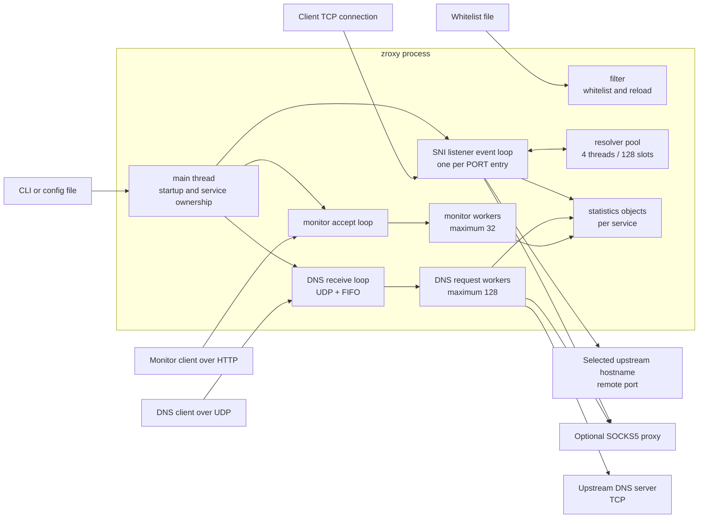

### Portable fallback

If Mermaid is not rendered by the viewer, the same topology is:

```text
                         +----------------------+
                         |      zroxy process   |
                         |                      |
 Client TCP ------------> SNI event loop(s) ----+----> direct upstream
                         |       |              |      or SOCKS5
                         |       v              |
                         |  resolver pool       |
                         |                      |
 DNS UDP ---------------> DNS receive/FIFO -----+----> DNS over TCP
                         |       |              |      direct or SOCKS5
                         |       v              |
                         |  DNS request workers |
                         |                      |
 Monitor HTTP ----------> monitor accept/workers |
                         |                      |
                         |  shared statistics  <--- SNI/DNS/monitor
                         +----------------------+
```

## Process startup and service lifecycle

The startup order is intentional: configuration and the whitelist are checked
before listeners become available.

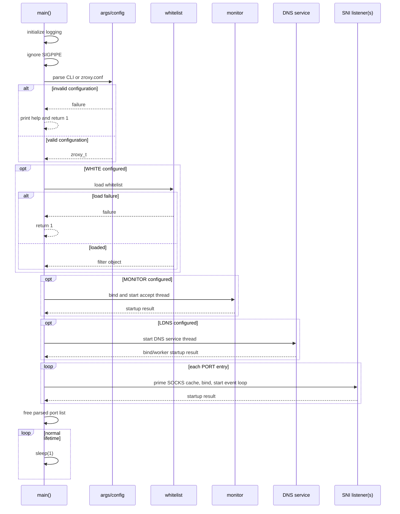

### Startup failure semantics

- Invalid CLI/configuration input returns `1` before services start.
- A configured whitelist that cannot be loaded returns `1`.
- A configured monitor that cannot bind or create its accept thread returns
  `1`.
- A configured DNS service that cannot initialize returns `1`.
- A configured SNI listener that cannot bind or start its event-loop thread
  returns `1`.
- An unconfigured service is skipped.
- A hostname SOCKS endpoint is primed at startup. A resolver-pool failure is a
  startup failure; a temporary failure to resolve the SOCKS hostname leaves the
  listener running, but new SOCKS connections fail until a usable cache entry
  exists.

The production main loop has no normal signal-driven shutdown path. The
`Free_DnsServer` call appears after the infinite sleep and is not reached on
the normal path. Process termination is therefore the effective cleanup path
for the detached services.

## Module map

| Path | Responsibility | Main boundary |
| --- | --- | --- |
| `src/main.c` | Startup order, service creation, process lifetime | Owns top-level configuration references |
| `src/args.c` | CLI/config parsing and validation | Produces `zroxy_t` |
| `src/args.h` | Configuration structures and parser API | Shared by startup/services |
| `src/config.h` | Length and queue bounds | Compile-time limits |
| `src/version.h` | Current version and release notes | Used by monitor output |
| `sniproxy/sniproxy.c` | SNI bind, SOCKS priming, listener startup | Creates one loop per configured port |
| `sniproxy/sni_event_loop.c` | Non-blocking SNI state machine | Owns listener/client/upstream fds on its thread |
| `sniproxy/sni_event_loop.h` | Event-loop API and test hooks | Joinable test loop and detached production loop |
| `sniproxy/sni_resolver.c` | Process-wide bounded resolver pool | Publishes completion records through pipes |
| `sniproxy/sni_resolver.h` | Resolver states, quotas, address policy | Defines resolver ownership protocol |
| `sniproxy/sniclient.c` | SNI connection cap and test entry point | 1024 live-connection slots |
| `sniproxy/filter/filter.c` | Whitelist load, match, reload watcher | Publishes a protected list |
| `network/net.c` | IPv4 listen/connect, HTTP/TLS host extraction | Protocol-independent socket helpers |
| `network/net_io.c` | Exact and deadline-bounded I/O | Shared timeout behavior |
| `network/socks/socks.c` | Blocking SOCKS5 client helper | Used by DNS and legacy/test paths |
| `dnsproxy/dnsserver.c` | DNS service bootstrap thread | Binds UDP socket and starts worker loop |
| `dnsproxy/dnsproxy.c` | UDP receive, FIFO, DNS request workers | Direct/SOCKS5 upstream forwarding |
| `dnsproxy/dns.c` | DNS decode/encode | Bounded packet representation |
| `fifo/fifo.c` | Mutex-protected fixed-size FIFO | Backpressure/drop boundary for DNS |
| `statistics/statistics.c` | Per-service counters | One mutex per statistics object |
| `statistics/monitor.c` | HTTP monitor accept/workers/JSON | Maximum 32 monitor workers |
| `log/log.c`, `log/loglock.c` | Logging | Shared logging path |

## Thread and ownership model

### Runtime threads

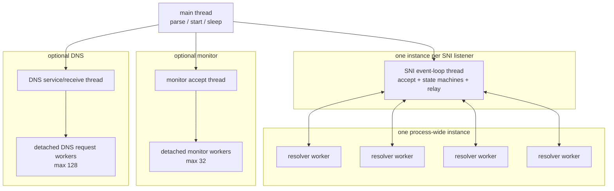

### Ownership rules

- `zroxy_t` owns the parsed port list, SOCKS configuration, DNS configuration,
  monitor settings, token, and whitelist path until startup transfers or frees
  them.
- The whitelist object is created by `main` and referenced by SNI and DNS
  services. Services do not own or free it.
- A production SNI loop receives a copy of `SniServer_t`; the pointed-to SOCKS,
  filter, and statistics objects remain owned by the caller/process.
- After startup, the SNI event-loop thread owns its listening socket, wake pipe,
  resolver completion pipe, accepted client sockets, and upstream sockets.
- SNI connection objects are allocated and freed by the same event-loop thread.
- `socks5_connect` owns the descriptor it creates during its operation. Failure
  paths close it and store `-1`.
- The DNS service stores aliases to the configuration's SOCKS and whitelist
  objects. Its `localdns_free` function does not free those aliases.
- Monitor workers close their client descriptor exactly once and release their
  worker slot before exiting.
- DNS workers free their copied request object and release their worker slot
  before exiting.

### File-descriptor ownership

```text
main
  ├─ creates/binds monitor fd ──> monitor accept thread
  ├─ creates/binds DNS fd ──────> DNS receive thread
  └─ creates/binds SNI fd ──────> owning SNI event-loop thread
                                      ├─ wake pipe
                                      ├─ resolver completion pipe
                                      ├─ accepted client fds
                                      └─ upstream fd per active connection
```

The event loop removes an fd from epoll/poll before closing it. Closed
descriptors are stored as `-1`, which prevents a later cleanup path from
closing the same descriptor again.

## SNI data plane

### Listener startup

For every `PORT` entry, `SniProxy_Start`:

1. primes the shared SOCKS hostname cache if a SOCKS hostname is configured;
2. creates and binds an IPv4 TCP listener;
3. creates a startup-report pipe;
4. starts one detached event-loop thread; and
5. waits for that thread to finish internal initialization before reporting
   success to `main`.

The event-loop initialization creates its resolver completion sink, wake pipe,
and epoll/poll backend. A listener is not reported ready until these resources
are available.

### Event sources

Each SNI loop can react to four kinds of event source:

| Source | Purpose |
| --- | --- |
| Listen fd | Accept new client sockets |
| Wake pipe | Stop a joinable/test listener |
| Resolver pipe | Receive completed DNS lookup records |
| Client/upstream fds | Drive the current connection state |

Linux uses `epoll`. Other supported builds use `poll`; a Linux test build can
force the poll backend with `SNI_FORCE_POLL`. The loop does not use `select` or
`FD_SET` for the SNI data plane.

### Client acceptance and capacity

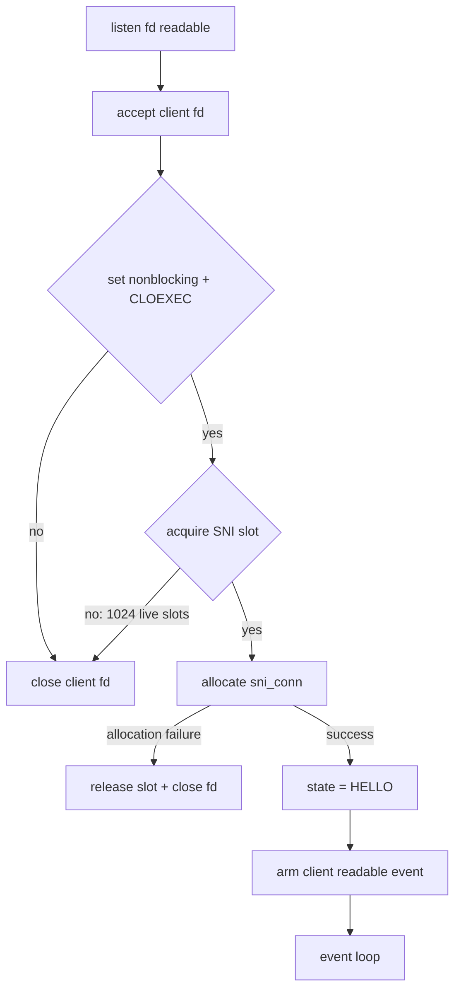

The 1024 limit is a limit on live SNI connection objects, not a number of
threads. The accepted socket is closed immediately when the cap is full.

### Connection state machine

The state names below correspond to the implementation constants in
`sni_event_loop.c`.

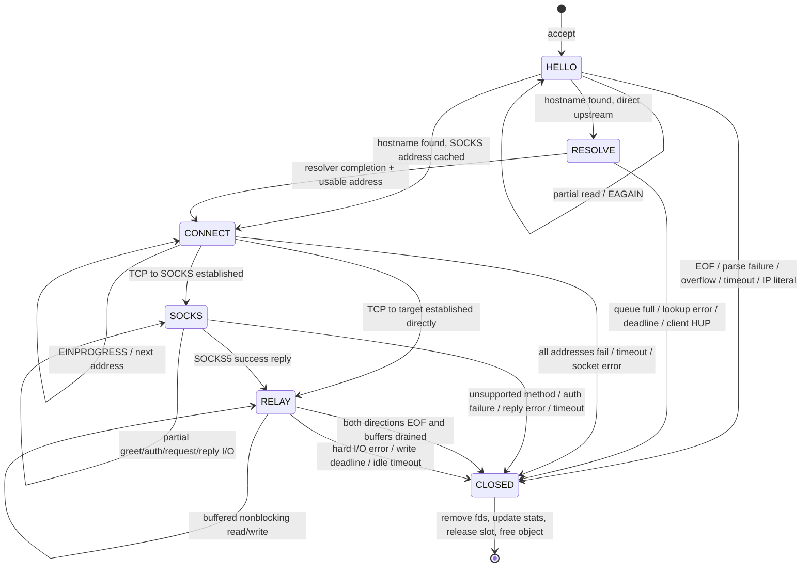

### State behavior

#### `HELLO`

- The client socket is readable while the initial buffer has room.
- `net_GetHost` tries HTTP `Host` extraction and then TLS ClientHello SNI
  extraction.
- The initial buffer is capped at 8192 bytes.
- The configured SNI timeout is an absolute connection-stage deadline.
- A second idle guard closes a client that stops supplying the next byte for
  five seconds.
- The hostname is lowercased and one trailing dot is removed.
- If a whitelist exists, the normalized hostname must match it.
- IP literals are rejected for SNI routing.

The initial bytes are not discarded. They are copied into the client-to-
upstream relay buffer when the connection enters `RELAY`.

#### `RESOLVE`

Only direct upstream connections use this state. The event loop submits the
hostname to the process-wide resolver and registers the client connection as
armed for error/hangup detection, but does not request client readability.
This prevents already-buffered client data from repeatedly waking the loop
while resolution is pending.

Resolver results arrive through the listener's completion pipe. The loop checks
the request ID, slot index, connection index, and connection generation before
applying a result, so a stale completion cannot be applied to a recycled
connection object.

#### `CONNECT`

The upstream socket is non-blocking. The loop tries the returned addresses in
order and waits for `POLLOUT`/`EPOLLOUT` when `connect()` returns
`EINPROGRESS`. `SO_ERROR` determines whether the connection succeeded. The
configured timeout covers the connect phase.

#### `SOCKS`

The upstream fd is the connection to the SOCKS5 server. The state machine sends
and receives these phases with partial-I/O support:

```text
GREETING -> optional USERNAME/PASSWORD AUTH -> CONNECT REQUEST -> REPLY
```

Only SOCKS5 methods `0x00` and `0x02` are accepted. The target hostname is
sent in the SOCKS5 domain request; zroxy does not locally resolve the final
target when SOCKS5 is used. Each phase has a deadline.

#### `RELAY`

There are two independent fixed buffers:

```text
client --read--> c2u[8192] --write--> upstream
client <--write-- u2c[8192] <--read-- upstream
```

The loop stops reading a direction while its buffer contains unsent bytes.
This is the backpressure rule that bounds per-connection memory and avoids
turning a slow peer into unbounded buffering.

A clean EOF in one direction is propagated with `shutdown(SHUT_WR)` only after
that direction's buffered data is flushed. The other direction can continue
until it also reaches EOF. A hard read/write error closes both sides.

### Relay timeout model

The loop uses monotonic deadlines. Depending on the state, the next wakeup is
the earliest of:

- initial SNI absolute deadline;
- five-second hello idle deadline;
- resolver deadline;
- connect deadline;
- current SOCKS phase deadline;
- pending client-to-upstream write deadline;
- pending upstream-to-client write deadline; or
- idle relay deadline after both buffers drain.

The loop calculates one wait timeout from those deadlines, waits in epoll/poll,
dispatches ready fds, then expires overdue connections and reaps dead objects.

## Resolver subsystem

The resolver is process-wide but completion is listener-local.

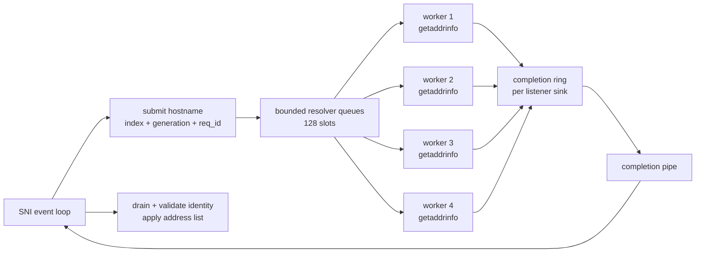

### Resolver bounds and slot states

- Four worker threads are created once for the process.
- The pool has 128 fixed slots; it does not grow with connection count.
- Each listener has a completion sink and a client lookup quota of 104.
- Resolver accounting reserves slots for direct/test work and infrastructure
  work so one listener cannot consume the entire pool.
- A slot moves through `FREE`, `QUEUED`, `RUNNING`, `DONE`, or `CANCELLED`.
- A slot index is never sufficient to identify a request; the request ID and
  connection generation are checked as well.
- `getaddrinfo`, pipe writes, and socket operations run without the pool mutex
  held.
- The event-loop thread never calls `getaddrinfo`.

### Hostname and address policy

Before lookup, hostnames are normalized to lowercase ASCII and one trailing dot
is removed. Lookup results are filtered before connection:

- IPv4-mapped IPv6 results are normalized to IPv4 for policy checks;
- loopback, unspecified, link-local, multicast, and listener self-connect
  results are removed;
- private IPv4 ranges are retained;
- the selected remote port is applied after resolution.

If all returned addresses are rejected, the SNI connection is closed without a
dial attempt.

### SOCKS cache

When the SOCKS endpoint is a hostname, the resolver primes a process-wide cache
at SNI listener startup and refreshes it in the background. A numeric SOCKS
endpoint bypasses hostname resolution. A listener can start after a temporary
SOCKS lookup failure, but a new connection requires a usable cached address.

Resolver shutdown waits for workers for a bounded interval. If a worker remains
inside `getaddrinfo`, the pool is intentionally left allocated until process
exit so its mutexes, queues, and slots are not destroyed while a worker may
still reference them.

## DNS data plane

DNS has a separate architecture from the non-blocking SNI loop.

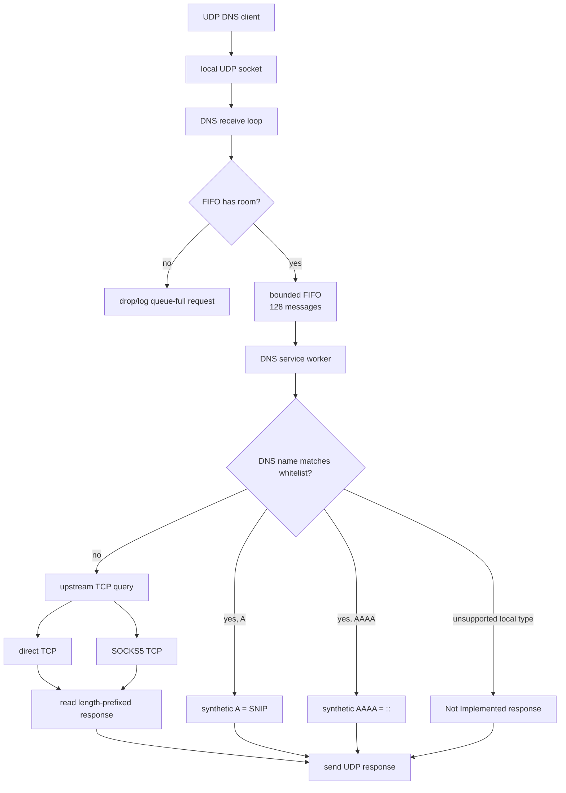

### DNS receive and worker flow

1. `dnsserver_init` starts a DNS service thread and waits for its startup
   condition result.
2. The service creates the DNS state, binds the configured IPv4 UDP socket,
   creates the FIFO, and starts one DNS worker loop.
3. The receive loop reads UDP datagrams into a bounded `dnsMessage_t` and
   enqueues them in the FIFO.
4. The DNS worker dequeues a message and reserves one of 128 detached request
   worker slots.
5. The request worker decodes the DNS message and either creates a local
   synthetic response or forwards the original query upstream.
6. Upstream DNS uses TCP framing: a two-byte network-order length followed by
   the DNS payload. Responses larger than the 512-byte internal message limit
   are rejected.
7. The worker sends the response back over UDP, updates statistics, frees its
   request copy, and releases its worker slot.

`recvfrom` failures, including `EINTR`, do not enqueue a job. FIFO insertion is
mutex-protected and has a hard capacity of 128 messages.

## Monitor and statistics

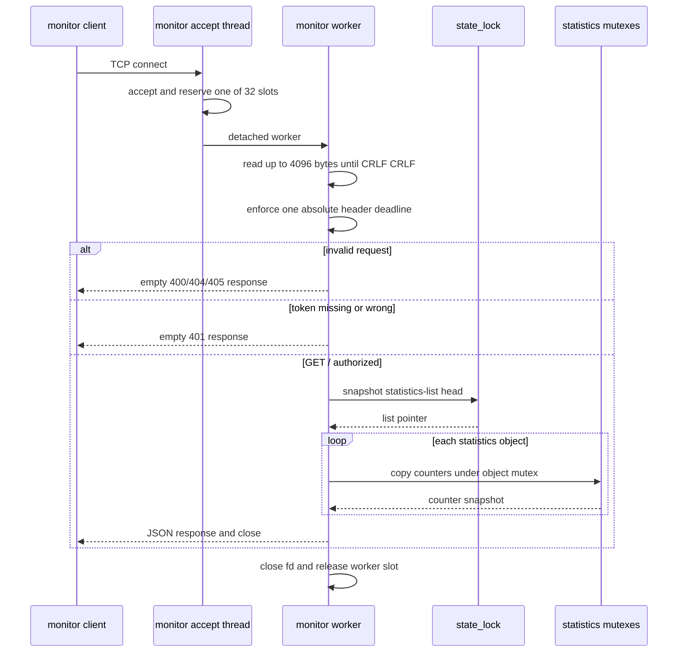

The monitor accepts only `GET /` with HTTP/1.0 or HTTP/1.1. A configured
Bearer token is required before counters are emitted. Without a token, anyone
who can reach the monitor socket can read the counters.

The monitor uses two lock levels:

- `state_lock` protects the linked-list head when statistics objects are added
  or the list is read;
- each `statistics_t::Lock` protects that object's counters.

The list lock is released before `state_get` takes an individual statistics
mutex, so those locks are not nested.

SNI and DNS statistics are updated on close/completion. SNI increments active
and total connection counters at acceptance, then records byte totals and
releases the active slot exactly once during connection destruction.

## Whitelist and configuration flow

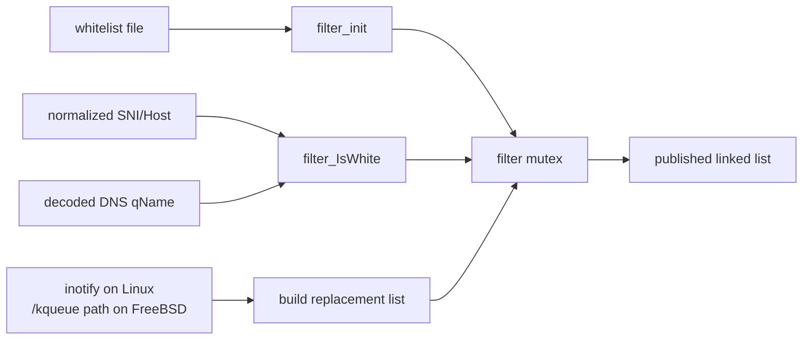

Startup loads the whitelist before listeners are started. A reload builds a
new list first, publishes it under the filter mutex, then frees the old list.
If opening, parsing, or allocating the replacement list fails, the old list is
kept. Readers hold the filter mutex while walking the current list.

The hostname used for matching is normalized before the SNI lookup and the DNS
path matches the decoded query name. The whitelist is not a universal firewall
for every protocol; it affects the hostname-aware paths described above.

## Configuration and object relationships

```text
                         +----------------+
                         |    zroxy_t     |
                         | parsed config  |
                         +-------+--------+
                                 |
       +-------------------------+--------------------------+
       |                         |                          |
       v                         v                          v
 +-----------+             +-----------+              +-----------+
 | monitor   |             | DNS config|              | SNI config|
 | settings  |             | dnshost_t |              | per port  |
 +-----+-----+             +-----+-----+              +-----+-----+
       |                         |                          |
       v                         v                          v
 monitor state             DNS service               SNI event loop
       |                         |                          |
       +-------------+-----------+--------------------------+
                     v
              shared filter / SOCKS / statistics references
```

The service objects use shared references rather than duplicating the filter
and SOCKS credentials. This is why the process lifetime currently keeps the
configuration and shared objects alive for as long as the detached services
may use them.

## Concurrency and locking

| Resource | Protected by | Used by |
| --- | --- | --- |
| Resolver pool queues/slots | pool mutex | resolver workers and submit/release paths |
| Resolver completion ring | sink mutex | resolver workers and owning event loop |
| Filter list | filter mutex | SNI/DNS readers and reload watcher |
| Statistics counters | one mutex per statistics object | SNI/DNS workers and monitor workers |
| Monitor statistics-list head | monitor `state_lock` | startup/add and monitor response generation |
| DNS FIFO indices and buffer | FIFO mutex | DNS receive and DNS worker loops |
| Monitor worker count | monitor worker mutex | monitor accept/workers |
| DNS worker count | DNS worker mutex | DNS service/workers |
| SNI live-connection count | SNI worker mutex | SNI accept/destruction paths |
| Joinable test listener state | listener mutex/condition | test caller and event-loop thread |

Important lock-order rules:

- The resolver pool mutex and a completion-sink mutex are never held together.
- Resolver blocking calls, pipe writes, and socket calls happen without the
  resolver pool mutex.
- Filter and statistics locks are not nested.
- A detached worker reserves its capacity before `pthread_create` and releases
  it on every exit path.

## Backpressure and bounded resources

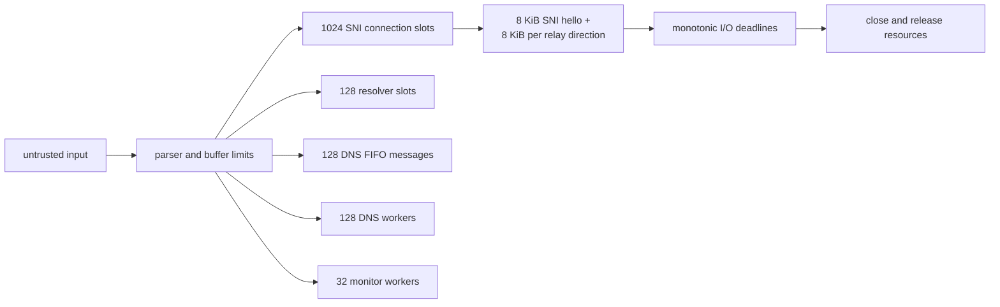

Current important bounds are:

| Resource | Bound | Enforcement point |
| --- | ---: | --- |
| SNI live connections | 1024 | `sni_worker_acquire` |
| SNI initial buffer | 8192 bytes | `SNI_HELLO_CAP` |
| SNI client-to-upstream relay buffer | 8192 bytes | `SNI_RELAY_CAP` |
| SNI upstream-to-client relay buffer | 8192 bytes | `SNI_RELAY_CAP` |
| SOCKS5 phase buffer | 600 bytes | `SNI_SOCKS_CAP` |
| Resolver workers | 4 | `SNI_RESOLVER_THREADS` |
| Resolver slots | 128 | `SNI_RESOLVER_SLOTS` |
| Per-listener client lookup quota | 104 | `SNI_RESOLVER_LISTENER_QUOTA` |
| DNS FIFO messages | 128 | `D_FIFO_Item` |
| DNS packet representation | 512 bytes | `DNS_MSG_SIZE` |
| DNS request workers | 128 | DNS worker accounting |
| Monitor workers | 32 | `MON_MAX_WORKERS` |
| Monitor request header | 4096 bytes | `MON_MAX_HEADER` |
| Config line | 1024 bytes | `_MaxConfigLine_` |
| Config value | 512 bytes | `_MaxConfigValue_` |
| Hostname | 253/255 bytes depending on layer | resolver/config limits |

Capacity rejection is deliberate at these boundaries. A full DNS FIFO, full
worker pool, full resolver quota, or full SNI connection cap should not turn
into unbounded memory growth.

## Error and cleanup paths

### SNI connection close

All normal SNI close paths converge on `conn_kill`:

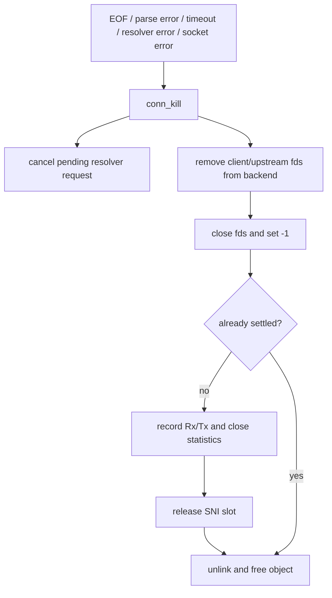

`conn_kill` is idempotent through the `dead` and `settled` flags. It cancels a
pending resolver request, removes watched descriptors, closes each descriptor
once, records statistics once when enabled, and releases the SNI slot once.

### Resolver close

When a listener stops, it marks its completion sink closed, drains available
completions, cancels live connection requests, and releases the sink. A worker
that completes after the sink is closed drops the completion safely according
to the resolver reference-counting protocol.

### Startup cleanup caveat

Startup failures return from `main` after the failing service reports its
result. The normal long-running path has been hardened around descriptor and
worker ownership, but cleanup of every configuration allocation across every
possible startup-failure ordering is not treated as a complete graceful
shutdown implementation.

## Observability

The monitor exposes one JSON document containing:

- `ZroxyVersion`;
- `CountOfOpenFile`;
- service uptime;
- maximum, active, and total connections; and
- total received/transmitted byte counts.

The statistics objects are registered for the SNI service and, when configured,
the DNS service. Monitor requests take snapshots; they do not directly inspect
SNI connection objects.

Logs include startup failures, filter reload outcomes, routing failures,
timeouts, DNS forwarding outcomes, and rejected capacity conditions. Secrets
and raw configuration values are not intended to be logged on configuration
failure paths.

## Testing architecture

The test layout mirrors the major boundaries:

| Test | Boundary covered |
| --- | --- |
| `test_net_host_extract` | HTTP Host and TLS SNI parser behavior |
| `test_filter_whitelist` | whitelist matching/reload logic |
| `test_dns_codec` | bounded DNS decode/encode |
| `test_args_parse` | CLI/config parsing and limits |
| `test_socks_handshake` | SOCKS5 handshake and deadlines |
| `test_sni_forwarding` | direct/SOCKS forwarding entry point |
| `test_sni_engine` | epoll event-loop state machine |
| `test_sni_engine_poll` | forced poll backend |
| `test_dnsproxy_tcp_io` | DNS upstream TCP framing and I/O |
| `test_io_limits` | exact I/O, EINTR, limits, worker caps |
| `test_process` | process startup and invalid configuration |
| `sni_e2e` | real zroxy SNI loopback exchange |
| `dns_e2e` | real zroxy DNS loopback exchange |
| `monitor_e2e` | real zroxy monitor exchange |

The SNI engine tests use fault injection to exercise partial reads/writes,
`EAGAIN`, `EINTR`, timeouts, half-close, resolver cancellation, stale
completions, allocation failures, connection caps, and both epoll and poll
backends. Stress and benchmark tests are separate and disabled from a plain
CTest run.

Passing focused tests does not establish Internet compatibility, production
capacity, or security-audit status. Socket-based tests must be run in an
environment that permits local socket creation.

## Design invariants

These are the rules future changes should preserve or update explicitly:

1. The SNI event-loop thread must not call blocking `getaddrinfo()`.
2. A client connection must not create a new pthread in the SNI data plane.
3. Client and upstream sockets must remain non-blocking in the SNI event loop.
4. Relay buffers must apply backpressure instead of growing with peer speed.
5. A clean half-close must drain buffered data before `shutdown(SHUT_WR)`.
6. One connection close must update statistics and release its capacity slot at
   most once.
7. Resolver completions must be validated against request identity and
   connection generation before they touch a connection.
8. A failed whitelist reload must not replace a valid published list with an
   incomplete list.
9. Configured service startup failures must be visible to `main`.
10. Monitor and DNS worker limits must be enforced before creating detached
    worker threads.
11. Descriptors must be removed from the event backend before close and set to
    `-1` afterward.
12. Documentation must distinguish implemented behavior, tested behavior, and
    unverified or environment-dependent behavior.

## Known limitations and open design work

- The production process has no graceful signal-driven shutdown protocol.
- The DNS service is detached and its normal queue loop is intentionally
  long-lived; the cleanup path after `main`'s sleep is not normally reached.
- DNS request handling still uses a detached thread per accepted DNS job within
  its 128-worker cap; it is not an event loop like SNI.
- Monitor request handling still uses `select` internally and one detached
  worker per accepted monitor client within its 32-worker cap.
- A resolver worker can remain allocated until process exit if bounded shutdown
  waits expire while it is inside `getaddrinfo()`.
- A musl build, live DNS-worker flooding, and some file-watcher concurrency
  scenarios require separate validation; they are not inferred from unit tests.

Any change to these areas should update this document, the relevant source
comments, and the tests that encode the affected invariant.
