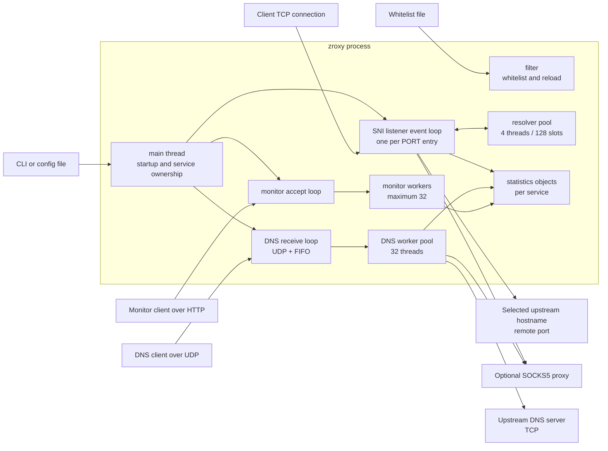
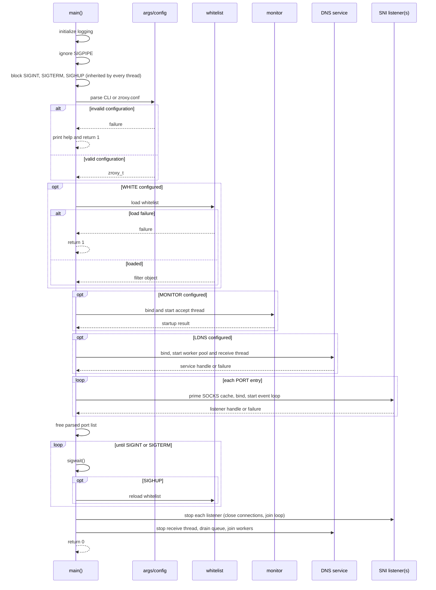
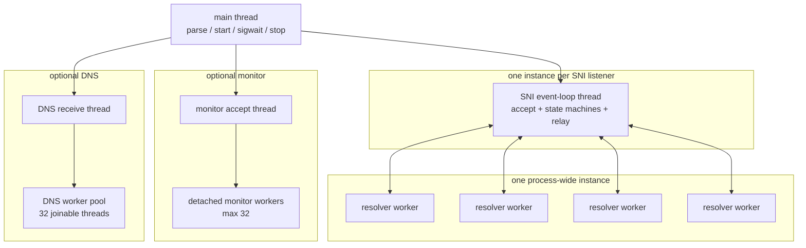
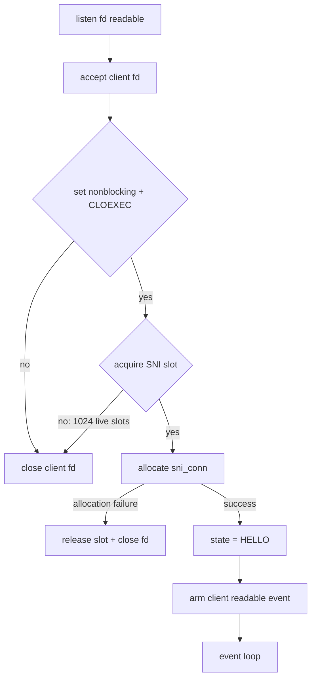
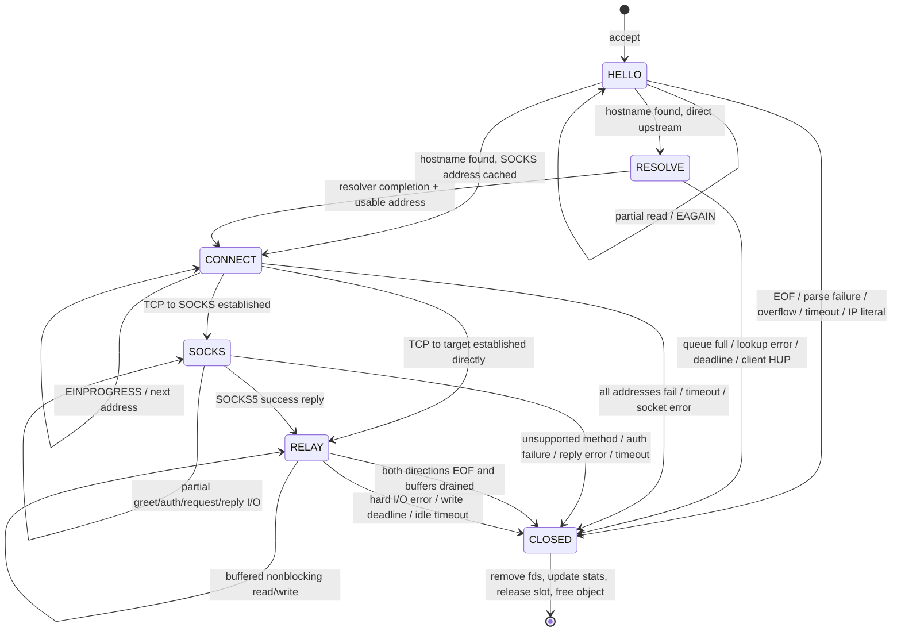
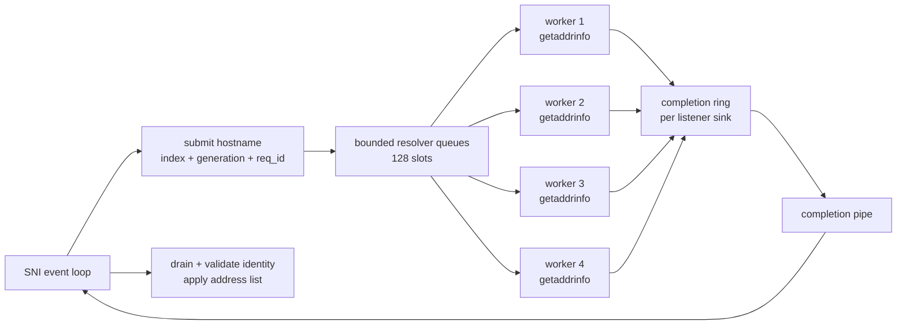
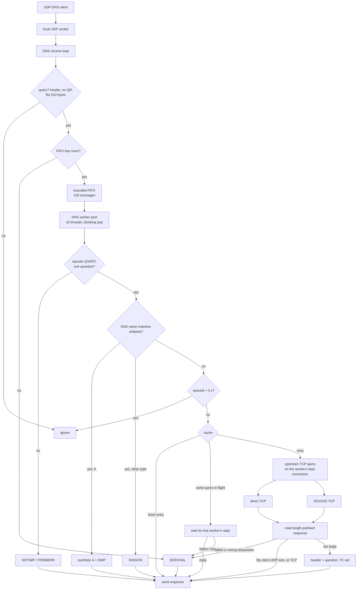
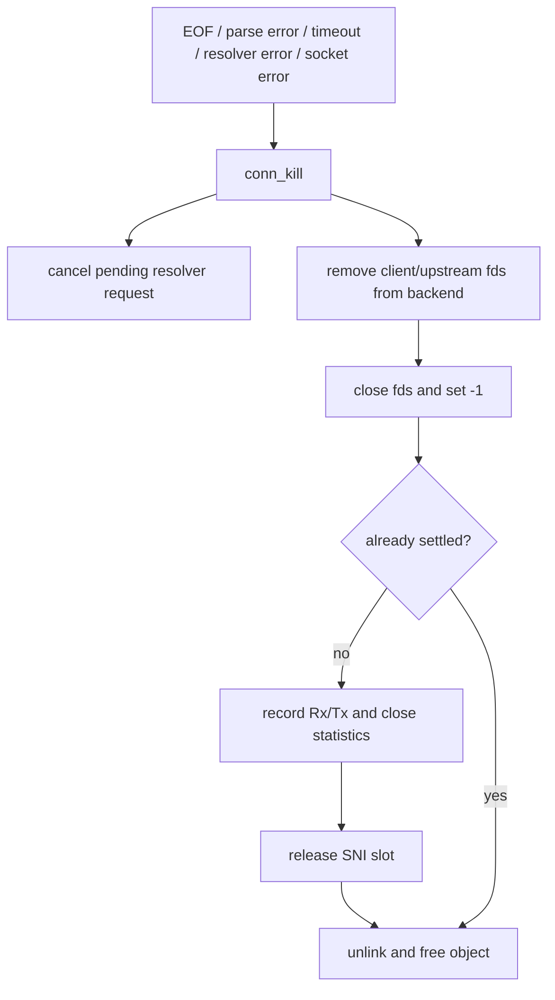

# Architecture

This document describes the architecture implemented by the current source
tree. It is a source-level design description, not a production-readiness
claim, capacity guarantee, or security audit.

The main implementation areas are:

- `include/zroxy/` — public headers of every module, included as
  `<zroxy/name.h>`;
- `src/` — process startup (`main.c`) and configuration (`args.c`);
- `src/sni/` — hostname-aware TCP forwarding and the SNI event loop (its
  event-loop and resolver headers are private to this directory);
- `src/dns/` — local UDP DNS receive, queueing, and upstream TCP forwarding;
- `src/stats/` — counters and the HTTP JSON monitor;
- `src/net/` — sockets, bounded I/O, hostname extraction, and SOCKS5 helpers;
- `src/filter/` — whitelist loading, matching, and reload;
- `src/fifo/` — the bounded DNS message queue;
- `src/log/` — logging and log synchronization.

Each `src/<module>/` directory builds one static library (`zroxy_<module>`);
the executable and the unit tests link only the libraries they need.

When this document says “the event loop”, it means the SNI listener loop in
`src/sni/sni_event_loop.c`. When it says “the main thread”, it means the
thread running `src/main.c`.

## Design summary

zroxy is one process containing three optional services:

1. one SNI listener event loop for each configured `PORT` entry;
2. one monitor accept loop when `MONITOR` is configured; and
3. one DNS receive loop and a fixed pool of DNS workers when `LDNS` is
   configured.

The SNI data plane does not create one pthread per client. Each listener owns
one long-lived event-loop thread and represents accepted clients as connection
objects managed by that thread. Hostname resolution is moved out of the event
loop into one bounded, process-wide resolver pool.

The DNS service uses a fixed pool of 32 worker threads that wait on the DNS
queue; each worker keeps one upstream TCP connection open between queries. The
monitor still uses detached pthreads for accepted work, bounded to 32.

`DCACHE` selects the bounded answer-cache capacity; zero leaves the cache
pointer null and disables caching. `DTTL` is copied to the DNS service and is
used for synthetic whitelist answers.

For a whitelisted non-A query, local DNS emits NOERROR/NODATA with one SOA in
the authority section. The SOA owner, primary name server, and responsible
name are the queried name; its serial is 1, its refresh/retry/expire values are
3600/600/86400, and its minimum field follows `DTTL`. The encoder calculates
the SOA RDLENGTH after writing its variable-length names. If the bounded UDP
response cannot fit the SOA, the service retries as valid NODATA without an
authority record rather than returning SERVFAIL.

The DNS service exposes cache, queue, and TCP-capacity counters through a
generic statistics extra hook. The monitor takes the statistics object's lock,
copies the base counters, and invokes that hook before closing the JSON object;
the hook takes the cache mutex only after the statistics lock. DNS shutdown
clears the hook before freeing the cache, so a monitor report cannot retain a
DNS pointer after service teardown.

Repeated DNS queue, TCP-capacity, and `NO DATA` errors use one-second
throttles. Receive-loop throttles are receive-thread-owned; the worker-shared
`NO DATA` throttle uses atomic state transitions and counters.

The main thread waits for signals: `SIGHUP` reloads the whitelist, and
`SIGINT`/`SIGTERM` stop the SNI listeners and the DNS service and exit with
status `0`.

## System context

The following diagram shows the production process and the external systems it
communicates with. Optional services and paths are included for context.



### Portable fallback

If Mermaid is not rendered by the viewer, the same topology is:

```text
                         +----------------------+
                         |      zroxy process   |
                         |                      |
 Client TCP ------------> SNI event loop(s) ----+----> direct upstream
                         |       |              |      or SOCKS5
                         |       v              |
                         |  resolver pool       |
                         |                      |
 DNS UDP ---------------> DNS receive/FIFO -----+----> DNS over TCP
                         |       |              |      direct or SOCKS5
                         |       v              |
                         |  DNS worker pool (32)|
                         |                      |
 Monitor HTTP ----------> monitor accept/workers |
                         |                      |
                         |  shared statistics  <--- SNI/DNS/monitor
                         +----------------------+
```

## Process startup and service lifecycle

The startup order is intentional: configuration and the whitelist are checked
before listeners become available.



### Startup failure semantics

- Invalid CLI/configuration input returns `1` before services start.
- DNS options without `LDNS` return `1`; `LDNS` without an upstream `DNS` also
  returns `1`. A whitelist without `SNIP` logs a warning and uses `0.0.0.0`.
- A configured whitelist that cannot be loaded returns `1`.
- A configured monitor that cannot bind or create its accept thread returns
  `1`.
- A configured DNS service that cannot initialize returns `1`.
- A configured SNI listener that cannot bind or start its event-loop thread
  returns `1`.
- An unconfigured service is skipped.
- A hostname SOCKS endpoint is primed at startup. A resolver-pool failure is a
  startup failure; a temporary failure to resolve the SOCKS hostname leaves the
  listener running, but new SOCKS connections fail until a usable cache entry
  exists.

### Signals and shutdown

`main` blocks `SIGINT`, `SIGTERM` and `SIGHUP` before any thread is created,
so every thread inherits the mask and only the main thread's `sigwait` sees
them.

- `SIGHUP` reloads the whitelist (the same path the file watcher uses). Without
  a whitelist it is logged and ignored.
- `SIGINT` or `SIGTERM` starts shutdown. Each SNI listener is stopped: its
  event loop is woken, closes every client and upstream connection, and is
  joined. The DNS receive thread is woken through its wake pipe and joined;
  the queue is then closed, workers answer what is already queued, close
  their upstream connections and are joined. `main` returns `0`.
- The monitor and the whitelist watcher are not stopped explicitly. They only
  read shared state and end with the process.

A startup failure also goes through the same stop path for anything already
started, then returns `1`.

## Module map

| Path | Responsibility | Main boundary |
| --- | --- | --- |
| `src/main.c` | Startup order, signal handling, shutdown | Owns top-level configuration and service handles |
| `src/args.c` | CLI/config parsing and validation | Produces `zroxy_t` |
| `include/zroxy/args.h` | Configuration structures and parser API | Shared by startup/services |
| `include/zroxy/config.h` | Length bounds | Compile-time limits |
| `include/zroxy/version.h` | Current version and release notes | Used by monitor output |
| `src/sni/sniproxy.c` | SOCKS priming, listener start/stop | One loop per configured port |
| `src/sni/sni_event_loop.c` | Non-blocking SNI state machine | Owns listener/client/upstream fds on its thread |
| `src/sni/sni_event_loop.h` | Event-loop API and test hooks (private) | Joinable listener: open/close |
| `src/sni/sni_resolver.c` | Process-wide bounded resolver pool | Publishes completion records through pipes |
| `src/sni/sni_resolver.h` | Resolver states, quotas, address policy (private) | Defines resolver ownership protocol |
| `src/sni/sniclient.c` | SNI connection cap and test entry point | 1024 live-connection slots |
| `src/filter/filter.c` | Whitelist load, match, reload watcher | Publishes an immutable hash-set snapshot |
| `src/net/net.c` | IPv4 listen/connect, HTTP/TLS host extraction | Protocol-independent socket helpers |
| `src/net/net_io.c` | Exact and deadline-bounded I/O | Shared timeout behavior |
| `src/net/socks.c` | Blocking SOCKS5 client helper | Used by DNS and legacy/test paths |
| `src/dns/dnsserver.c` | DNS service start/stop and receive thread | Owns the UDP socket and wake pipe |
| `src/dns/dnsproxy.c` | UDP receive, queue, worker pool | Direct/SOCKS5 upstream forwarding over kept connections |
| `src/dns/dns.c` | DNS decode/encode | Bounded packet representation |
| `src/fifo/fifo.c` | Fixed-size FIFO with blocking pop | Backpressure/drop boundary for DNS |
| `src/stats/statistics.c` | Per-service counters | One mutex per statistics object |
| `src/stats/monitor.c` | HTTP monitor accept/workers/JSON | Maximum 32 monitor workers |
| `src/log/log.c`, `src/log/loglock.c` | Logging | Shared logging path |

## Thread and ownership model

### Runtime threads



### Ownership rules

- `zroxy_t` owns the parsed port list, SOCKS configuration, DNS configuration,
  monitor settings, token, and whitelist path until startup transfers or frees
  them.
- The whitelist object is created by `main` and referenced by SNI and DNS
  services. Services do not own or free it.
- An SNI loop receives a copy of `SniServer_t`; the pointed-to SOCKS,
  filter, and statistics objects remain owned by the caller/process. `main`
  keeps the listener handle and stops it with `sniproxy_stop`.
- After startup, the SNI event-loop thread owns its listening socket, wake pipe,
  resolver completion pipe, accepted client sockets, and upstream sockets.
- SNI connection objects are allocated and freed by the same event-loop thread.
- `socks5_connect` owns the descriptor it creates during its operation. Failure
  paths close it and store `-1`.
- The DNS service stores aliases to the configuration's SOCKS and whitelist
  objects. Its `localdns_free` function does not free those aliases.
- Monitor workers close their client descriptor exactly once and release their
  worker slot before exiting.
- Each DNS worker owns at most one upstream connection, opened on demand and
  closed when the worker exits. The DNS service object owns the UDP socket, the
  wake pipe, the queue and the worker threads; `dnsserver_stop` releases them.

### File-descriptor ownership

```text
main
  ├─ creates/binds monitor fd ──> monitor accept thread
  ├─ creates/binds DNS fd ──────> DNS receive thread (+ wake pipe)
  │                                   └─ one upstream fd per DNS worker
  └─ creates/binds SNI fd ──────> owning SNI event-loop thread
                                      ├─ wake pipe
                                      ├─ resolver completion pipe
                                      ├─ accepted client fds
                                      └─ upstream fd per active connection
```

The event loop removes an fd from epoll/poll before closing it. Closed
descriptors are stored as `-1`, which prevents a later cleanup path from
closing the same descriptor again.

## SNI data plane

### Listener startup

For every `PORT` entry, `sniproxy_start`:

1. primes the shared SOCKS hostname cache if a SOCKS hostname is configured;
2. creates and binds an IPv4 TCP listener;
3. starts one joinable event-loop thread; and
4. waits for that thread to finish internal initialization before returning
   the listener handle to `main`.

The event-loop initialization creates its resolver completion sink, wake pipe,
and epoll/poll backend. A listener is not reported ready until these resources
are available.

### Event sources

Each SNI loop can react to four kinds of event source:

| Source | Purpose |
| --- | --- |
| Listen fd | Accept new client sockets |
| Wake pipe | Stop a joinable/test listener |
| Resolver pipe | Receive completed DNS lookup records |
| Client/upstream fds | Drive the current connection state |

Linux uses `epoll`. Other supported builds use `poll`; a Linux test build can
force the poll backend with `SNI_FORCE_POLL`. The loop does not use `select` or
`FD_SET` for the SNI data plane.

### Client acceptance and capacity



The 1024 limit is a limit on live SNI connection objects, not a number of
threads. The accepted socket is closed immediately when the cap is full.

### Connection state machine

The state names below correspond to the implementation constants in
`sni_event_loop.c`.



### State behavior

#### `HELLO`

- The client socket is readable while the initial buffer has room.
- `net_get_host` tries HTTP `Host` extraction and then TLS ClientHello SNI
  extraction.
- The initial buffer is capped at 8192 bytes.
- The configured SNI timeout is an absolute connection-stage deadline.
- A second idle guard closes a client that stops supplying the next byte for
  five seconds.
- The hostname is lowercased and one trailing dot is removed.
- If a whitelist exists, the normalized hostname must match it.
- IP literals are rejected for SNI routing.

The initial bytes are not discarded. They are copied into the client-to-
upstream relay buffer when the connection enters `RELAY`.

#### `RESOLVE`

Only direct upstream connections use this state. The event loop submits the
hostname to the process-wide resolver and registers the client connection as
armed for error/hangup detection, but does not request client readability.
This prevents already-buffered client data from repeatedly waking the loop
while resolution is pending.

Resolver results arrive through the listener's completion pipe. The loop checks
the request ID, slot index, connection index, and connection generation before
applying a result, so a stale completion cannot be applied to a recycled
connection object.

#### `CONNECT`

The upstream socket is non-blocking. The loop tries the returned addresses in
order and waits for `POLLOUT`/`EPOLLOUT` when `connect()` returns
`EINPROGRESS`. `SO_ERROR` determines whether the connection succeeded. The
configured timeout covers the connect phase.

#### `SOCKS`

The upstream fd is the connection to the SOCKS5 server. The state machine sends
and receives these phases with partial-I/O support:

```text
GREETING -> optional USERNAME/PASSWORD AUTH -> CONNECT REQUEST -> REPLY
```

Only SOCKS5 methods `0x00` and `0x02` are accepted. The target hostname is
sent in the SOCKS5 domain request; zroxy does not locally resolve the final
target when SOCKS5 is used. Each phase has a deadline.

#### `RELAY`

There are two independent fixed buffers:

```text
client --read--> c2u[8192] --write--> upstream
client <--write-- u2c[8192] <--read-- upstream
```

The loop stops reading a direction while its buffer contains unsent bytes.
This is the backpressure rule that bounds per-connection memory and avoids
turning a slow peer into unbounded buffering.

A clean EOF in one direction is propagated with `shutdown(SHUT_WR)` only after
that direction's buffered data is flushed. The other direction can continue
until it also reaches EOF. A hard read/write error closes both sides.

### Relay timeout model

The loop uses monotonic deadlines. Depending on the state, the next wakeup is
the earliest of:

- initial SNI absolute deadline;
- five-second hello idle deadline;
- resolver deadline;
- connect deadline;
- current SOCKS phase deadline;
- pending client-to-upstream write deadline;
- pending upstream-to-client write deadline; or
- idle relay deadline after both buffers drain.

The loop calculates one wait timeout from those deadlines, waits in epoll/poll,
dispatches ready fds, then expires overdue connections and reaps dead objects.

## Resolver subsystem

The resolver is process-wide but completion is listener-local.



### Resolver bounds and slot states

- Four worker threads are created once for the process.
- The pool has 128 fixed slots; it does not grow with connection count.
- Each listener has a completion sink and a client lookup quota of 104.
- Resolver accounting reserves slots for direct/test work and infrastructure
  work so one listener cannot consume the entire pool.
- A slot moves through `FREE`, `QUEUED`, `RUNNING`, `DONE`, or `CANCELLED`.
- A slot index is never sufficient to identify a request; the request ID and
  connection generation are checked as well.
- `getaddrinfo`, pipe writes, and socket operations run without the pool mutex
  held.
- The event-loop thread never calls `getaddrinfo`.

### Hostname and address policy

Before lookup, hostnames are normalized to lowercase ASCII and one trailing dot
is removed. Lookup results are filtered before connection:

- lookups ask for IPv4 only (`AF_INET`), because IPv6 is not proxied;
- IPv4-mapped IPv6 results are normalized to IPv4 for policy checks;
- loopback, unspecified, link-local, multicast, and listener self-connect
  results are removed;
- private IPv4 ranges are retained;
- the selected remote port is applied after resolution.

If all returned addresses are rejected, the SNI connection is closed without a
dial attempt.

### SOCKS cache

When the SOCKS endpoint is a hostname, the resolver primes a process-wide cache
at SNI listener startup and refreshes it in the background. A numeric SOCKS
endpoint bypasses hostname resolution. A listener can start after a temporary
SOCKS lookup failure, but a new connection requires a usable cached address.

Resolver shutdown waits for workers for a bounded interval. If a worker remains
inside `getaddrinfo`, the pool is intentionally left allocated until process
exit so its mutexes, queues, and slots are not destroyed while a worker may
still reference them.

## DNS data plane

DNS has a separate architecture from the non-blocking SNI loop.



### DNS receive and worker flow

1. `dnsserver_start` creates the DNS state and the FIFO, binds the configured
   IPv4 UDP socket, starts `DNS_WORKER_COUNT` (32) joinable workers, then
   starts the receive thread. Any failure undoes what was started and returns
   `NULL`.
2. The receive thread polls the UDP socket and a wake pipe. Each datagram is
   read into a bounded `dnsMessage_t` and pushed into the FIFO. Datagrams
   shorter than a header, larger than 510 bytes, or with QR set are ignored.
   A full FIFO answers SERVFAIL from the receive thread.
3. Workers block on the FIFO's condition variable (`fifo_pop_wait`); there is
   no polling or sleep. Each worker handles one query at a time.
4. A non-QUERY opcode gets NOTIMP and a QDCOUNT other than 1 gets FORMERR.
   Otherwise the worker decodes the message. A whitelisted name is answered
   locally: A gets `SNIP` with a 300-second TTL, every other type (AAAA,
   HTTPS, SVCB, ...) gets NODATA, because IPv6 is not proxied and a real
   address would bypass the proxy. Anything else, including a message the
   decoder rejects, is forwarded upstream unchanged.
5. A forwarded query that waited in the FIFO longer than
   `DNS_QUEUE_MAX_AGE_MS` (3 s) is dropped: its client has given up or
   retried. Otherwise the answer cache (`src/dns/dnscache.c`) is consulted;
   see below.
6. Upstream DNS uses TCP framing: a two-byte network-order length followed by
   the DNS payload. Each write and read has the configured DNS timeout as a
   monotonic deadline for the whole exchange. Up to 1232 bytes of the response
   are kept and the rest is read and discarded, so the connection stays in
   step. A response larger than the client's UDP size (512, or its EDNS0 size
   clamped to 1232) is sent as header and question with TC set; the client
   retries over the local TCP listener (below).
7. A worker keeps its upstream connection open for the next query. Before
   reuse it drops the connection if the server already closed it (readable
   with no request outstanding). If a reused connection still fails, the query
   is retried once on a fresh connection; a failure on a fresh connection is
   final, so a broken upstream is not hammered.
8. The worker sends the response back over UDP and updates statistics. A
   failed upstream exchange is answered with SERVFAIL instead of silence. A
   reply whose id or question differs from the query is treated as a failure
   and its connection is closed, so it is never relayed or cached.

### Local DNS over TCP

- `dnsserver_start` binds a TCP listener on the UDP socket's address and
  port. If that fails the service logs it and stays UDP-only.
- The receive thread polls it with the UDP socket and wake pipe. An accepted
  connection is queued as a `DNS_MSG_TCP_CONN` job; beyond 8 open
  connections (`DNS_TCP_MAX_CONNS`), or with a full FIFO, it is closed.
- A worker that takes the job serves the connection itself: it reads
  length-prefixed queries one after another (pipelined queries are answered
  in order), runs each through the same path as UDP, and frames each reply.
  It stops after 32 queries, 3 s idle, a malformed or QR-set message, or a
  stop request (the wake pipe stays readable after `dnsserver_stop`), then
  closes the socket. At most 8 of the 32 workers are therefore busy with TCP.
- TCP replies are never truncated. The worker uses a 64 KiB heap buffer for
  them; UDP workers keep a 1232-byte stack buffer.
- A reply shared by the cache holds at most 1232 bytes. A TCP query whose
  shared reply is longer fetches it again itself.

### DNS cache and coalescing

- The key is the lowercased question (name, type, class) plus the RD and CD
  bits, whether the query carries EDNS0, and its DO bit. The id and the
  client's spelling of the name are not part of the key; a hit is rewritten
  with both before it is sent.
- Only complete NOERROR and NXDOMAIN replies without TC, of at most 1232
  bytes, are stored. The lifetime is the smallest answer/authority TTL,
  capped at 3600 s, or 300 s for NXDOMAIN and NODATA. TTLs are lowered by the
  time spent in the cache. A TTL of 0 is not stored.
- At most 2048 entries; the least recently used is evicted first. Expired
  entries are removed when looked up or evicted.
- While one worker fetches a key (the leader), workers with the same key wait
  for its reply instead of going upstream, for up to twice the DNS timeout.
  A failed fetch answers its followers with SERVFAIL. Up to 64 keys can be in
  flight; beyond that a query is forwarded on its own.
- One mutex guards entries and flights. Upstream I/O never runs with it held.
- Whitelisted names are answered before the cache is consulted, so a
  whitelist reload takes effect at once. There is no stale serving yet.

`dnsserver_stop` writes to the wake pipe and joins the receive thread, then
closes the FIFO: workers drain what is already queued, close their upstream
connections and exit, and are joined.

`recvfrom` failures, including `EINTR`, do not enqueue a job. The FIFO has a
hard capacity of 128 messages.

## Monitor and statistics


The monitor accepts only `GET /` with HTTP/1.0 or HTTP/1.1. A configured
Bearer token is required before counters are emitted. Without a token, anyone
who can reach the monitor socket can read the counters.

The monitor uses two lock levels:

- `stats_lock` protects the linked-list head when statistics objects are added
  or the list is read;
- each `statistics_t::Lock` protects that object's counters.

The list lock is released before `stats_get` takes an individual statistics
mutex, so those locks are not nested.

SNI and DNS statistics are updated on close/completion. SNI increments active
and total connection counters at acceptance, then records byte totals and
releases the active slot exactly once during connection destruction.

## Whitelist and configuration flow

```mermaid
flowchart LR
    File[whitelist file]
    Load[filter_init]
    List[published snapshot\nhash sets + pattern list]
    Mutex[filter rwlock]
    Match[filter_match]
    SNI[normalized SNI/Host]
    DNS[decoded DNS qName]
    Watch[inotify on parent dir (Linux)\nkqueue on file (FreeBSD)\nor SIGHUP]
    Reload[build replacement snapshot]

    File --> Load --> Mutex --> List
    SNI --> Match
    DNS --> Match
    Match --> Mutex
    Watch --> Reload --> Mutex
```

Startup loads the whitelist before listeners are started. Each line is
trimmed and lower-cased; blank lines and `#` comments are skipped. Entries are
split into three groups:

- exact names, kept in a hash set;
- `*.suffix` entries (no other wildcard), kept as `.suffix` in a second hash
  set and checked once per label of the queried name;
- any other `*`/`?` pattern, kept in a list and matched linearly.

A lookup lower-cases the queried name, drops one trailing dot, and takes the
read lock. Cost is proportional to the number of labels plus the number of
generic patterns, not to the size of the list. A plain entry matches only that
exact name, never a longer name that starts with it.

A reload builds a complete new snapshot first, swaps it in under the write
lock, then frees the old one; the write lock guarantees no reader still uses
it. If opening, parsing, or allocating the replacement fails, the old snapshot
is kept. Reloads come from the file watcher or from `SIGHUP`. On Linux the
watcher watches the parent directory for `IN_CLOSE_WRITE`/`IN_MOVED_TO` on the
file name, so a save by rename is seen and a half-written file is not loaded.

The DNS path matches the decoded query name and the SNI path matches the
normalized SNI/Host name. The whitelist is not a universal firewall for every
protocol; it affects the hostname-aware paths described above.

## Configuration and object relationships

```text
                         +----------------+
                         |    zroxy_t     |
                         | parsed config  |
                         +-------+--------+
                                 |
       +-------------------------+--------------------------+
       |                         |                          |
       v                         v                          v
 +-----------+             +-----------+              +-----------+
 | monitor   |             | DNS config|              | SNI config|
 | settings  |             | dnshost_t |              | per port  |
 +-----+-----+             +-----+-----+              +-----+-----+
       |                         |                          |
       v                         v                          v
 monitor state             DNS service               SNI event loop
       |                         |                          |
       +-------------+-----------+--------------------------+
                     v
              shared filter / SOCKS / statistics references
```

The service objects use shared references rather than duplicating the filter
and SOCKS credentials. `main` stops the SNI listeners and the DNS service
before it frees the configuration they reference. The whitelist and monitor
objects are not freed: the watcher and monitor threads may still read them
until the process exits.

The argument parser allocates one `dnshost_t` for all DNS-related options, so
CLI and configuration-file option order does not change defaults. `LDNS` marks
the listener as explicitly enabled; later validation decides whether the
configured DNS options are sufficient to start the service.

## Concurrency and locking

| Resource | Protected by | Used by |
| --- | --- | --- |
| Resolver pool queues/slots | pool mutex | resolver workers and submit/release paths |
| Resolver completion ring | sink mutex | resolver workers and owning event loop |
| Filter snapshot pointer | filter rwlock (read: lookup, write: swap) | SNI/DNS readers, reload watcher, `SIGHUP` |
| Statistics counters | one mutex per statistics object | SNI/DNS workers and monitor workers |
| Monitor statistics-list head | monitor `stats_lock` | startup/add and monitor response generation |
| DNS FIFO indices, buffer, closed flag | FIFO mutex + not-empty condition | DNS receive thread and DNS workers |
| Monitor worker count | monitor worker mutex | monitor accept/workers |
| SNI live-connection count | SNI worker mutex | SNI accept/destruction paths |
| Listener startup/stop state | listener mutex/condition | `main` and the event-loop thread |

Important lock-order rules:

- The resolver pool mutex and a completion-sink mutex are never held together.
- Resolver blocking calls, pipe writes, and socket calls happen without the
  resolver pool mutex.
- Filter and statistics locks are not nested.
- A detached monitor worker reserves its capacity before `pthread_create` and
  releases it on every exit path.

## Backpressure and bounded resources


Current important bounds are:

| Resource | Bound | Enforcement point |
| --- | ---: | --- |
| SNI live connections | 1024 | `sni_worker_acquire` |
| SNI initial buffer | 8192 bytes | `SNI_HELLO_CAP` |
| SNI client-to-upstream relay buffer | 8192 bytes | `SNI_RELAY_CAP` |
| SNI upstream-to-client relay buffer | 8192 bytes | `SNI_RELAY_CAP` |
| SOCKS5 phase buffer | 600 bytes | `SNI_SOCKS_CAP` |
| Resolver workers | 4 | `SNI_RESOLVER_THREADS` |
| Resolver slots | 128 | `SNI_RESOLVER_SLOTS` |
| Per-listener client lookup quota | 104 | `SNI_RESOLVER_LISTENER_QUOTA` |
| DNS FIFO messages | 128 | `DNS_QUEUE_LEN` |
| DNS packet representation | 512 bytes | `DNS_MSG_SIZE` |
| DNS workers / kept upstream connections | 32 | `DNS_WORKER_COUNT` |
| Monitor workers | 32 | `MON_MAX_WORKERS` |
| Monitor request header | 4096 bytes | `MON_MAX_HEADER` |
| Config line | 1024 bytes | `ZROXY_MAX_CONFIG_LINE` |
| Config value | 512 bytes | `ZROXY_MAX_CONFIG_VALUE` |
| Hostname | 253/255 bytes depending on layer | resolver/config limits |

Capacity rejection is deliberate at these boundaries. A full DNS FIFO, full
worker pool, full resolver quota, or full SNI connection cap should not turn
into unbounded memory growth.

## Error and cleanup paths

### SNI connection close

All normal SNI close paths converge on `conn_kill`:



`conn_kill` is idempotent through the `dead` and `settled` flags. It cancels a
pending resolver request, removes watched descriptors, closes each descriptor
once, records statistics once when enabled, and releases the SNI slot once.

### Resolver close

When a listener stops, it marks its completion sink closed, drains available
completions, cancels live connection requests, and releases the sink. A worker
that completes after the sink is closed drops the completion safely according
to the resolver reference-counting protocol.

### Process shutdown

On `SIGINT`/`SIGTERM`, and on a startup failure after some services started,
`main` stops each SNI listener (every live connection goes through the close
path above) and then the DNS service, as described in
[Signals and shutdown](#signals-and-shutdown). The whitelist, its watcher and
the monitor are left to process exit.

## Observability

The monitor exposes one JSON document containing:

- `ZroxyVersion`;
- `CountOfOpenFile`;
- service uptime;
- maximum, active, and total connections; and
- total received/transmitted byte counts.

The `DNS_Server` object also reports cache hits, misses, shared in-flight
queries, current entries, evictions, stale queue drops, queue-full events,
refused TCP connections, and active TCP connections.

The statistics objects are registered for the SNI service and, when configured,
the DNS service. Monitor requests take snapshots; they do not directly inspect
SNI connection objects.

Logs include startup failures, filter reload outcomes, routing failures,
timeouts, DNS forwarding outcomes, and rejected capacity conditions. Secrets
and raw configuration values are not intended to be logged on configuration
failure paths.

## Testing architecture

The test layout mirrors the major boundaries:

| Test | Boundary covered |
| --- | --- |
| `test_net_host_extract` | HTTP Host and TLS SNI parser behavior |
| `test_filter_whitelist` | whitelist matching: exact, suffix, generic patterns, case, no prefix match |
| `test_dns_codec` | bounded DNS decode/encode |
| `test_args_parse` | CLI/config parsing and limits |
| `test_socks_handshake` | SOCKS5 handshake and deadlines |
| `test_sni_forwarding` | direct/SOCKS forwarding entry point |
| `test_sni_engine` | epoll event-loop state machine |
| `test_sni_engine_poll` | forced poll backend |
| `test_dnsproxy_tcp_io` | DNS upstream TCP framing and I/O |
| `test_io_limits` | exact I/O, EINTR, limits, worker caps |
| `test_process` | process startup and invalid configuration |
| `sni_e2e` | real zroxy SNI loopback exchange |
| `dns_e2e` | real zroxy DNS: forwarding, failures, whitelist, reload, upstream connection reuse |
| `monitor_e2e` | real zroxy monitor exchange |
| `lifecycle_e2e` | `SIGHUP` reload and clean `SIGTERM`/`SIGINT` exit |

The SNI engine tests use fault injection to exercise partial reads/writes,
`EAGAIN`, `EINTR`, timeouts, half-close, resolver cancellation, stale
completions, allocation failures, connection caps, and both epoll and poll
backends. Stress and benchmark tests are separate and disabled from a plain
CTest run.

Passing focused tests does not establish Internet compatibility, production
capacity, or security-audit status. Socket-based tests must be run in an
environment that permits local socket creation.

## Design invariants

These are the rules future changes should preserve or update explicitly:

1. The SNI event-loop thread must not call blocking `getaddrinfo()`.
2. A client connection must not create a new pthread in the SNI data plane.
3. Client and upstream sockets must remain non-blocking in the SNI event loop.
4. Relay buffers must apply backpressure instead of growing with peer speed.
5. A clean half-close must drain buffered data before `shutdown(SHUT_WR)`.
6. One connection close must update statistics and release its capacity slot at
   most once.
7. Resolver completions must be validated against request identity and
   connection generation before they touch a connection.
8. A failed whitelist reload must not replace a valid published list with an
   incomplete list.
9. Configured service startup failures must be visible to `main`.
10. Monitor worker limits must be enforced before creating detached worker
    threads. DNS uses a fixed worker pool and must not create threads per
    query.
11. Descriptors must be removed from the event backend before close and set to
    `-1` afterward.
12. Documentation must distinguish implemented behavior, tested behavior, and
    unverified or environment-dependent behavior.

## Known limitations and open design work

- Shutdown does not stop the monitor or the whitelist watcher; they end with
  the process.
- Each DNS worker sends one query at a time on its connection (no TCP
  pipelining). Throughput toward a slow upstream is bounded by
  `DNS_WORKER_COUNT` divided by the upstream round-trip time.
- Workers are woken in condition-variable order, so under light load queries
  spread across workers and up to `DNS_WORKER_COUNT` upstream connections may
  be opened before they are reused.
- Monitor request handling still uses `select` internally and one detached
  worker per accepted monitor client within its 32-worker cap.
- A resolver worker can remain allocated until process exit if bounded shutdown
  waits expire while it is inside `getaddrinfo()`.
- A musl build, live DNS-worker flooding, and some file-watcher concurrency
  scenarios require separate validation; they are not inferred from unit tests.

Any change to these areas should update this document, the relevant source
comments, and the tests that encode the affected invariant.
